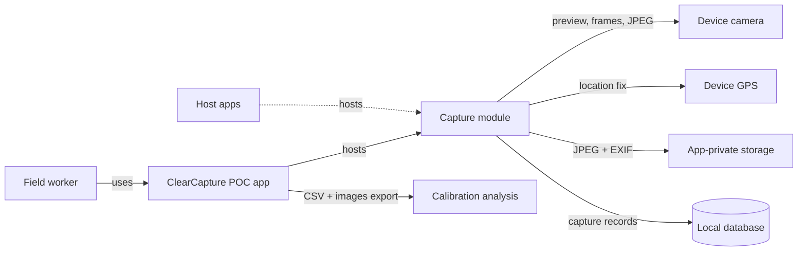
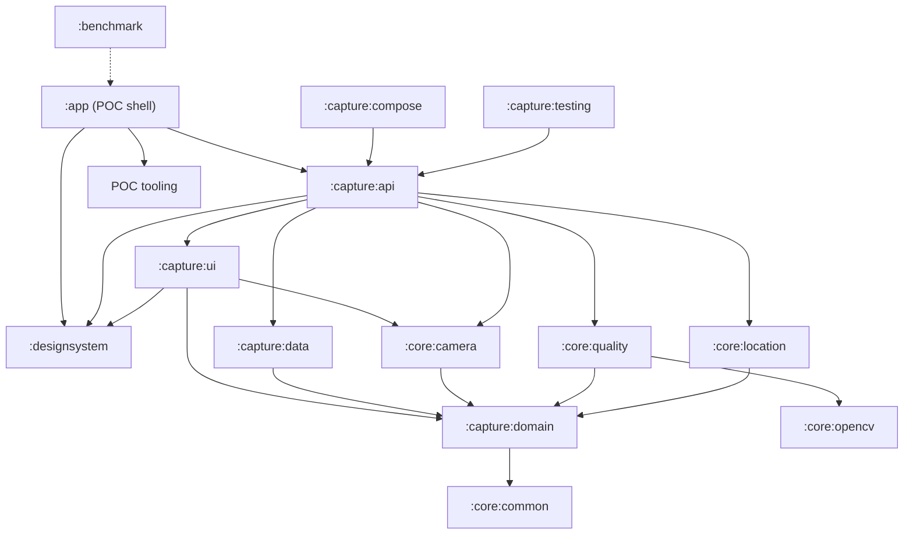
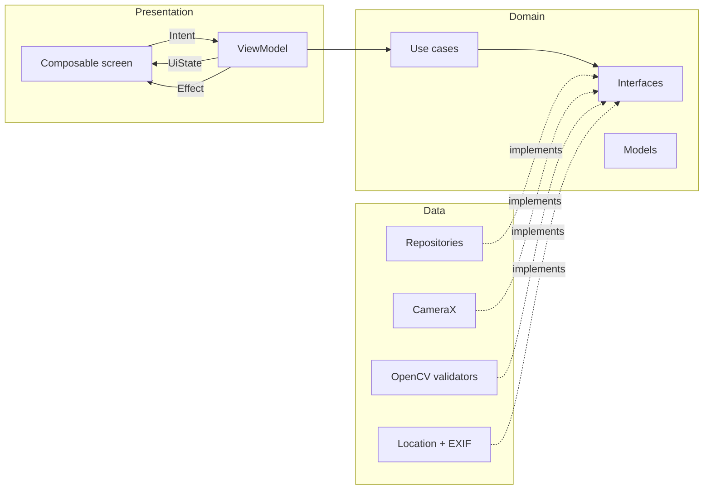
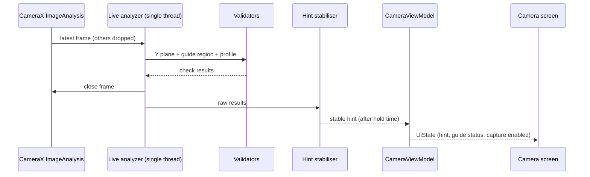
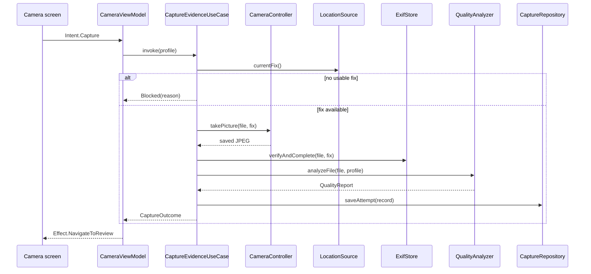

# ClearCapture SDK: High-Level Design (HLD)

| | |
|---|---|
| Product | ClearCapture SDK (evidence capture for Android) and its POC app |
| Package | `com.clearcapture.clearcapture` |
| Status | Draft for review, revision 4, SDK edition (13 November 2026) |
| Date | 13 November 2026 |
| Companions | `LLD.md`, `SDK_REQUIREMENTS.md` (host contract), `DESIGN_SYSTEM.md`; resolved versions in `VERSIONS.md`; review findings in `DESIGN_REVIEW.md`. `Camera_Quality_Validation_Engine.pdf` is background only: where it differs (Hilt everywhere, module names, WorkManager upload, `CV_64F`), these four documents win |

## 1. Purpose, scope and non-goals

### 1.1 Purpose

Field workers photograph waste containers, workers, vehicles and general site evidence. A photograph is only useful as evidence if it is clear, shows the subject, and proves where it was taken. ClearCapture checks each photograph on the device, explains any problem to the worker straight away, and accepts only photographs that pass.

The work is delivered in two steps:

1. A POC app that we run on real rugged Android tablets to test and calibrate the checks.
2. The same capture feature, packaged as an SDK that any Android app can add as a dependency, including apps that do not use Compose, Hilt or Kotlin.

### 1.2 In scope

- Guided capture with four profiles: Container, Person, Vehicle, General.
- Six deterministic image-quality checks using traditional computer vision.
- Mandatory location metadata written into every accepted image and verified.
- Live guidance on the preview and a full check on the saved image.
- Local storage of capture records and a calibration toolset in the POC.
- A public SDK API, a host contract (permissions, requirements, responsibilities) and a UI design system.

### 1.3 Non-goals

- No AI or ML models, no cloud inference, no paid services.
- No recognition of what the subject is. The checks measure image properties and geometry; they cannot confirm that the subject really is a container, person or truck.
- No upload or sync. The host app owns that.
- No video.
- No number-plate or text reading.

### 1.4 Decisions

The project owner confirmed these on 13 November 2026 (`VERSIONS.md`, section 8). Any of them can be changed later; the last column says what a change would touch.

| # | Decision | Effect if changed |
|---|---|---|
| 1 | `minSdk` is 26 | Changes API fallbacks for location and storage |
| 2 | The first host apps and their Kotlin and Compose versions are not known. Host apps may use any dependency-injection library and any UI toolkit, or none; the SDK supports the ranges in `VERSIONS.md`, section 7 | None for the design; the supported ranges may move |
| 3 | The SDK ships `arm64-v8a`. `x86_64` is added to debug builds of the POC only, so it runs on an emulator | Adding `armeabi-v7a` means a larger APK |
| 4 | A `Warning` can be accepted; a `Fail` cannot be overridden. Both remain profile flags | Changes review-screen actions |
| 5 | A location fix must be at most 60 s old and 50 m accurate | Threshold values only |
| 6 | Accepted images live in app-private storage and retention is the host's decision. Google Play Services is used when present, the platform GPS provider otherwise | Changes file layout and retention; without Play Services the platform path is the only path |
| 7 | Distribution: a local Maven repository in the build, and GitHub Packages from the release workflow. The licence is not decided (section 15) | Publishing configuration only |

## 2. System context

Nothing leaves the device in the POC except a manual export started by the tester.

## 3. Module structure

| Module | Responsibility | Depends on |
|---|---|---|
| `:app` | POC shell: navigation host, theme, DI root, debug overlay, tuning screen, capture log, export, component gallery | `:capture:api`; `:designsystem` for the component gallery |
| `:capture:api` | The main module the host compiles against: config, launcher, result, replaceable interfaces. Wires the graph and maps domain types to the public ones (`FlowOutcome` to `CaptureResult`, `Appearance` to `CcAppearance`) | `:capture:ui`, `:capture:domain`, `:capture:data`, all `:core:*` modules, `:designsystem` |
| `:capture:compose` | Published as `clearcapture-compose`: the navigation destination (`evidenceCaptureGraph`, `navigateToEvidenceCapture`) | `:capture:api` |
| `:capture:testing` | Published as `clearcapture-testing`: fakes for host tests | `:capture:api` |
| `:capture:ui` | Compose screens, ViewModels, MVI contracts | `:capture:domain`, `:designsystem`; `:core:camera` for the preview composable only |
| `:capture:domain` | Pure Kotlin: models, use cases, interfaces. Never references `:capture:api` types | `:core:common` |
| `:capture:data` | Repository implementations, Room, profile loading | `:capture:domain` |
| `:core:camera` | CameraX behind `CameraController`, plus the preview composable that binds the camera to the screen | `:capture:domain` |
| `:core:opencv` | OpenCV loading, conversion of raw buffers and dimensions to `Mat`, `Mat` pool | none |
| `:core:quality` | Six validators, score calculator; adapts the domain `FrameData` to `:core:opencv` | `:capture:domain`, `:core:opencv` |
| `:core:location` | Location source, fix rules, EXIF GPS write and verify | `:capture:domain` |
| `:core:common` | Dispatchers, result types, logging interface | none |
| `:designsystem` | Design tokens, theme, UI components and its own appearance input type `CcAppearance` (`DESIGN_SYSTEM.md`) | Compose and Material 3 only |
| `:sample-host-*` | Small apps that consume the published SDK the way a real host would | published artifact only |
| `:benchmark` | Macrobenchmark, Baseline Profile generation | `:app` |
| `build-logic` | Convention plugins | n/a |

### 3.1 Reuse contract

- The host app adds `:capture:api`. Nothing else in the host app changes.
- The host launches capture in one of two ways: an `ActivityResultContract` (in `:capture:api`), or a Compose navigation destination (in `:capture:compose`). Both take a `CaptureConfig` and return a `CaptureResult`.
- No library module references `:app`, an `Application` subclass, the app's `BuildConfig`, or the host's theme. Screens always use the SDK's own `ClearCaptureTheme`, never the host's `MaterialTheme`.
- The host can replace `CaptureProfileProvider`, `CaptureRepository`, `CaptureLogger` and `CaptureAnalytics`. Each has a working default. These host-facing interfaces and their plain data models are declared in `:capture:api`; internal adapters map them to the domain ports, so domain types never appear in the host's code.
- The mapping runs one way only. The domain never references `:capture:api` types: it ends a flow with its own `FlowOutcome`, and `:capture:api` maps that to the public `CaptureResult`. In the same way `:designsystem` takes its own `CcAppearance`, to which `:capture:api` maps the public `Appearance`.
- Each library module has its own namespace, the resource prefix `cc_`, consumer R8 rules, and declares only its own permissions.
- Only `:capture:api` is public API (Kotlin explicit API mode), together with the two small optional modules that sit on top of it, `:capture:compose` and `:capture:testing`. Everything else is `internal` wherever the module boundary allows.
- POC-only tooling (overlay, tuning, log, export) stays in `:app` and reads the module through the same public API plus a diagnostics interface (`CaptureDiagnostics`) that is marked opt-in and is not meant for production hosts.

### 3.2 SDK packaging

- Hosts see one dependency, `com.clearcapture:clearcapture`. The internal modules are published together as a single AAR so hosts cannot reach internals. An optional `clearcapture-compose` artifact (module `:capture:compose`) adds the navigation destination, and `clearcapture-testing` (module `:capture:testing`) provides fakes for host tests; both depend only on `:capture:api`.
- The primary launch path is the SDK's own Activity through an `ActivityResultContract`. It works from Java, from XML-based apps and from Compose apps alike.
- The SDK does not use Hilt, and does not require the host to use any dependency-injection library. Objects are wired by an internal `CaptureGraph` with constructor injection. Hilt is used only in the POC and sample apps.
- No work at app start: no `Application` subclass, no auto-start provider, no background service. `ClearCapture.initialize` only stores configuration and is optional. This rule is about app start; an explicit `checkReadiness` call may read (for example, ask the profile provider about a profile ID).
- Permissions are handled by the SDK by default, or by the host if it chooses (`PermissionMode`). `ClearCapture.checkReadiness` tells the host what is missing without showing UI and without changing anything.
- The SDK has its own theme and design system, with a small set of host-settable appearance options. It neither inherits nor alters the host's theme.
- The SDK never throws into the host for runtime conditions; every outcome is a `CaptureResult`.
- Semantic versioning, a checked public API, and a published compatibility matrix per release.

The full host contract, including the permission behaviour in every case and the split of privacy responsibilities, is in `SDK_REQUIREMENTS.md`.

## 4. Architecture

### 4.1 Layers

Dependencies point inward. The domain layer has no Android, CameraX, OpenCV, Room or Hilt imports, so it compiles and tests as plain Kotlin.

### 4.2 MVVM with MVI

- One ViewModel per screen exposes one immutable `StateFlow<UiState>`.
- The screen sends `Intent`s. The ViewModel turns results from use cases into internal `Change` objects and passes them through a pure `reduce(state, change)` function.
- One-off events (navigate, haptic, toast) go out as `Effect`s through a channel, so they are not replayed on rotation.
- Composables are stateless: they take state and an `onIntent` lambda.

### 4.3 SOLID in practice

| Principle | How it shows up |
|---|---|
| Single responsibility | One class per validator; camera, location, EXIF and persistence each in their own module |
| Open/closed | Validators are listed in one internal registry. A new validator is one new class and one line in the registry; a new profile is data only |
| Liskov | Every `QualityValidator` returns the same result type and honours the same contract (no throwing, no side effects) |
| Interface segregation | Small interfaces: `LocationSource`, `ExifStore`, `CameraController`, `QualityAnalyzer`, each used only by those who need it |
| Dependency inversion | Use cases depend on domain interfaces; CameraX, OpenCV, Play Services and Room are details behind them |

## 5. Main flows

### 5.1 Live validation loop

Frames the analyzer cannot keep up with are dropped, never queued. The preview is not affected by analysis speed.

### 5.2 Capture and post-capture validation

### 5.3 Review

The review screen shows the image, the overall verdict and the reason for each warning or failure. `Accept` moves the file from pending to accepted storage, marks the record accepted and returns `CaptureResult.Accepted` to the host. `Retake` deletes the pending file and returns to the camera with the profile kept.

### 5.4 Location

A capture session starts as soon as the permissions are granted, whether or not the profile screen is shown (the host may pass the profile directly). It starts location updates and pre-warms OpenCV, so both are usually ready before the camera screen. It stops when the capture flow ends. When the profile requires location (`location.required`, the single source of truth; all four bundled profiles require it), the capture button stays disabled, with the reason shown, until there is a usable fix.

## 6. Data

| Data | Where | Notes |
|---|---|---|
| Pending image | App cache directory | Deleted on retake, on cancel, and at next start if orphaned |
| Accepted image | App-private files directory, by date | JPEG with EXIF; name is the capture UUID |
| Capture record | Room database | One row per attempt: profile, verdict, per-check metrics, location, timestamps, device, file path |
| Profiles and thresholds | JSON asset, overridable by the host | Versioned |
| Tuning overrides (POC) | DataStore | Never shipped in the library |
| Export (POC) | Zip of CSV plus images, shared by the tester | Manual only |

Retention is the host's decision. The module exposes `delete(captureId)` and `purgeOlderThan(instant)`; the POC keeps everything until cleared.

## 7. Technology choices

Versions are those resolved on 13 November 2026. `docs/VERSIONS.md` is the full record (coordinates, release dates, compatibility checks) and the build takes them from `gradle/libs.versions.toml`.

| Area | Choice | Resolved version | Why |
|---|---|---|---|
| Language | Kotlin | 2.4.21 | Team standard; coroutines and Flow |
| Build | Android Gradle Plugin with built-in Kotlin, version catalog, convention plugins | AGP 9.5.1, Gradle 9.9.1, JDK 17, `compileSdk` 37 | Uniform module setup |
| UI | Jetpack Compose, Material 3 | BOM 2026.09.00 (Compose 1.12.1) | Stateless screens fit MVI |
| Camera | CameraX, with the stable `CameraXViewfinder` from `camera-compose` for the preview | 1.6.2 | Handles device differences; writes EXIF location at capture |
| Image analysis | OpenCV Android AAR from Maven Central | 4.14.0 | Offline, deterministic, Apache 2.0 |
| DI | Manual constructor injection inside the SDK (internal `CaptureGraph`). Hilt with KSP in the POC and sample apps only | Hilt 2.60.1, KSP 2.3.13 (apps) | A library that uses Hilt forces every host to be a Hilt app |
| Async | Coroutines, Flow | 1.11.0 | Structured concurrency |
| Persistence | Room, DataStore | Room 2.8.5, DataStore 1.3.0 | Local records and settings |
| Metadata | AndroidX ExifInterface | 1.4.2 | Read, write and verify GPS tags |
| Location | Play Services Location, platform `LocationManager` fallback | 21.4.0 | Works without mobile data |
| Performance | Baseline Profile, Macrobenchmark | 1.5.0 | Startup and journey timing |
| Quality | JUnit, Turbine, Compose UI tests, Roborazzi screenshot tests on the JVM, detekt for static analysis | JUnit 4.13.2, Turbine 1.2.1, Roborazzi 1.79.0, detekt 1.23.8 | |

## 8. Cross-cutting concerns

### 8.1 Threading

| Work | Runs on |
|---|---|
| UI, state reduction | Main |
| Live frame analysis | One dedicated single-thread executor |
| Post-capture analysis, OpenCV init | Default dispatcher (CPU) |
| File, EXIF, database | IO dispatcher |
| Camera callbacks | CameraX executors, handed off immediately |

Dispatchers are injected so tests can replace them. No image, disk or database work runs on the main thread.

### 8.2 Errors

Errors are sealed types in the domain. Each maps to one user message and one recovery action. Lower layers catch exceptions at their boundary and convert them; no exception crosses a layer.

### 8.3 Permissions

The SDK declares camera and fine and coarse location in its own manifest. By default it requests them itself inside the flow, each with a plain-language reason, and handles denial, permanent denial, approximate-only location and location services being off. A host with its own permission onboarding can switch to host-managed mode, in which the SDK never asks and reports what is missing. Location is requested only for profiles that require it. The SDK needs no storage, background-location or internet permission. Every case is specified in `SDK_REQUIREMENTS.md`, section 5.

### 8.4 Configuration

Everything tunable (thresholds, hint hold time, location limits, whether warnings can be accepted) is profile data, not code.

### 8.5 Logging and analytics

The module logs through `CaptureLogger` and reports events through `CaptureAnalytics`. Defaults are no-ops in release. Logs never include coordinates or file contents.

### 8.6 Accessibility and localisation

TalkBack labels on every control, live hints announced politely, font scaling respected, status never shown by colour alone. All user-facing text is in string resources.

## 9. User experience principles

Tokens, components, layouts and wording rules are specified in `DESIGN_SYSTEM.md`. The principles:

- The preview fills the screen. Controls are large (56 dp or more) and high contrast for outdoor use with gloves.
- One short hint at a time, chosen by the priority order defined once in LLD section 3.4.
- Hints do not flicker: a hint changes only after the condition has held for the configured time (400 ms to start).
- The capture button always shows whether it is enabled and, if not, why. It is disabled only in the four cases listed in LLD section 3.4; a warning never disables it.
- A rejected photograph always states the exact reason and the next action.
- Rotation always keeps the state. When capture is launched through the module's own Activity the camera session is not restarted on rotation; inside a host navigation graph that depends on how the host Activity handles configuration changes (LLD section 7).
- Every state has a designed screen: permission needed, camera unavailable, waiting for location, analysing, pass, warning, fail, storage full.

## 10. Performance strategy

| Metric | Budget |
|---|---|
| POC cold start to first frame | ≤ 1.5 s |
| Camera screen to first preview frame | ≤ 1.0 s warm, ≤ 1.5 s cold |
| Live analysis per frame (p95) | ≤ 60 ms at 640×480 |
| Live analysis rate | ≥ 10 frames per second |
| Shutter to image saved | ≤ 800 ms |
| Image saved to verdict (p95) | ≤ 1.5 s |
| Janky frames on camera screen | < 1 % |
| Memory over 50 captures | Flat |

These are proposed targets for a mid-range rugged tablet and must be confirmed by measurement.

How the design meets them:

- OpenCV loads off the main thread, pre-warmed when the capture session starts.
- The analyzer keeps only the latest frame and works on the Y plane directly; colour conversion happens only for the glare check.
- `Mat` objects come from a small pool and are released deterministically.
- Post-capture analysis decodes the JPEG once into a normalised analysis image (long side about 2000 px) plus a full-resolution crop of the centre of the guide for the blur check. This keeps memory bounded on high-megapixel cameras and makes thresholds comparable between cameras. Independent checks run concurrently.
- Analyzer results are throttled before they reach Compose, and the preview is not recomposed by them.
- A Baseline Profile covers startup and the capture journey.
- R8 full mode in release; only the required ABIs are packaged.

## 11. Device compatibility

- Capabilities are discovered through CameraX and Camera2 characteristics (resolutions, autofocus, flash, hardware level), never by model name.
- Fixed-focus cameras: tap-to-focus is hidden and the blur threshold comes from that device's calibration.
- Algorithms are the same on every device. Only thresholds differ, through profiles that carry per-device overrides keyed by the reported camera characteristics. The overrides are applied once the camera reports its capabilities; until then the base profile is used (LLD section 3).
- The actual output resolution is read after binding, because CameraX may choose a different one from the request.
- Native libraries are checked for 16 KB page-size support.

## 12. Security and privacy

- Photographs can show people, and every image carries a location. Both are personal data.
- Files are in app-private storage and are not added to the device gallery.
- No network permission is needed by the module.
- The export in the POC is started by the tester and goes through the system share sheet.
- Mock-location fixes are detected and flagged on the record.
- The host decides retention and upload; the module provides delete and purge.

## 13. Risks and limitations

| Risk | Impact | Mitigation |
|---|---|---|
| Thresholds differ a lot between cameras | False accepts or rejects | Calibration dataset per device; per-device overrides |
| Framing and obstruction checks misread busy backgrounds | Wrong hints | Use them as warnings, keep the guided overlays, allow accept-on-warning |
| No GPS fix indoors or under cover | Workers blocked | Clear waiting message; configurable accuracy and age. There is no override without a fix in 0.1.0: a host that must capture without one supplies a profile with `location.required = false` |
| Smooth subjects (a clean container wall) look like blur or obstruction | False rejects | Measure on the guide region and on the whole image; combine metrics |
| OpenCV adds APK size | Larger download | Package required ABIs only; report size |
| Analysis too slow on older tablets | Laggy hints | Lower analysis resolution adaptively; drop frames |
| The checks cannot confirm the subject type | A sharp photo of the wrong thing passes | Stated limitation; guided profiles; human review downstream |

## 14. Test strategy and POC acceptance

- Unit tests: validators on fixture images, reducers, use cases, score calculator, location rules. Validator tests run on the JVM with desktop OpenCV natives, on fixture images produced by a Kotlin generator in the test source set of `:core:quality` (`VERSIONS.md`, section 4).
- Instrumented tests: EXIF GPS round trip, Room, camera binding on a device.
- UI tests: each screen state. Screenshot tests use Roborazzi on the JVM.
- Workflow: `main` is protected, `development` is the base branch, and CI (build, tests, detekt 1.23.8) runs on every pull request.
- Benchmarks: startup and capture journey.
- Field calibration: at least 30 good and 30 bad photographs per profile per device, labelled by hand, to measure false-accept and false-reject rates.

| Case | Expected |
|---|---|
| Clear, well-framed image with a valid fix | Pass; GPS tags in the JPEG |
| Motion-blurred or out-of-focus image | Fail, blur reason |
| Too dark or overexposed | Warning or fail per profile |
| Strong reflection on the subject | Warning or fail per profile |
| Subject cut off or too small | Framing warning |
| Lens or subject partly blocked | Obstruction warning |
| Low-resolution or corrupted file | Fail |
| Location off, permission denied or no fix | Capture blocked with the reason |
| Portrait and landscape | Correct orientation, state kept |
| 50 captures in a row | No crash, flat memory, budgets held |

## 15. Open questions

The other questions of revision 3 are resolved in section 1.4. Two remain:

1. Licence and terms under which other apps may use the SDK.
2. The first host apps' Kotlin and Compose versions. Until they are known the SDK supports the ranges in `VERSIONS.md`, section 7.
