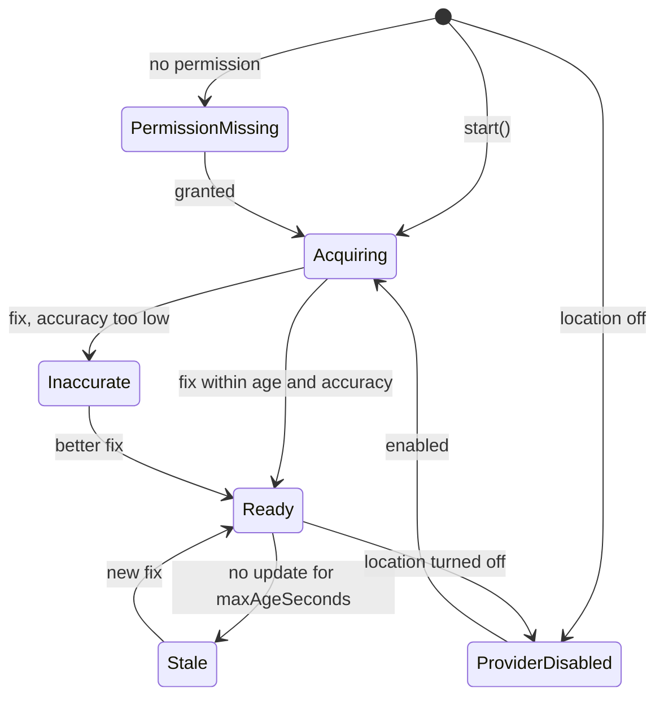

# ClearCapture SDK: Low-Level Design (LLD)

| | |
|---|---|
| Package | `com.clearcapture.clearcapture` |
| Status | Revision 5, SDK edition (14 November 2026): implementation notes in section 16 |
| Date | 13 November 2026 |
| Companions | `HLD.md`, `SDK_REQUIREMENTS.md`, `DESIGN_SYSTEM.md` |

The Kotlin in this document is design-level: it fixes names, shapes and contracts. It has not been compiled. All threshold values are starting points to be calibrated on real devices.

## 1. Package structure

```text
:capture:api          com.clearcapture.clearcapture.api
    CaptureConfig, CaptureResult, QualitySummary, GeoStamp
    EvidenceCaptureContract
    ClearCapture (entry point), ClearCaptureConfig, PermissionMode, Appearance,
    Readiness, Blocker, CaptureDependencies, CaptureEventListener
    CaptureDiagnostics (opt-in, for the POC tooling)
    spi/  CaptureProfileProvider, CaptureRepository, CaptureLogger, CaptureAnalytics

:capture:compose      com.clearcapture.clearcapture.compose   (artifact clearcapture-compose)
    EvidenceCaptureNavigation (evidenceCaptureGraph, navigateToEvidenceCapture)
    depends on :capture:api

:capture:testing      com.clearcapture.clearcapture.testing   (artifact clearcapture-testing)
    fakes for host tests: a launcher that returns canned results without a camera
    depends on :capture:api

:capture:domain       com.clearcapture.clearcapture.domain
    model/      CaptureProfile, Thresholds, DeviceOverride, CameraTraits, QualityCheck,
                CheckResult, QualityReport, Verdict, ReasonCode, LocationFix,
                LocationStatus, CaptureRecord, CaptureStatus, FrameData, GuideRegion,
                CaptureError, AcceptedCapture, FlowOutcome, FailureCode
    profile/    ProfileResolver
    port/       CameraController, QualityAnalyzer, LocationSource, ExifStore,
                CaptureRepository, CaptureProfileProvider, FileStore, Clock
    usecase/    ObserveLiveQualityUseCase, CaptureEvidenceUseCase,
                AcceptCaptureUseCase, DiscardCaptureUseCase,
                ObserveLocationStatusUseCase, GetProfilesUseCase
    session/    CaptureSession
    hint/       HintStabilizer, HintPrioritizer

:capture:ui           com.clearcapture.clearcapture.ui
    permission/ PermissionScreen, PermissionViewModel, PermissionContract
    profile/    ProfileScreen, ProfileViewModel, ProfileContract
    camera/     CameraScreen, CameraViewModel, CameraContract, CameraReducer,
                GuideOverlay, HintBanner, LocationChip, ShutterButton
    review/     ReviewScreen, ReviewViewModel, ReviewContract, ReviewReducer
    navigation/ CaptureNavGraph
    mvi/        MviViewModel
    (all screens use :designsystem components only)

:capture:data         com.clearcapture.clearcapture.data
    profile/    AssetCaptureProfileProvider, ProfileDto, ProfileMapper
    record/     RoomCaptureRepository, CaptureDatabase, CaptureEntity, CaptureDao
    file/       AppFileStore

:core:camera          com.clearcapture.clearcapture.camera
    CameraXController, CameraPreview (composable), FrameDataAdapter,
    CameraCapabilityReader

:core:opencv          com.clearcapture.clearcapture.opencv
    OpenCvInitializer, MatPool, FrameMats, JpegDecoder
    (no module dependencies: takes raw buffers and dimensions, never domain types)

:core:quality         com.clearcapture.clearcapture.quality
    QualityValidator, OpenCvQualityAnalyzer, QualityScoreCalculator,
    FrameMatsAdapter (domain FrameData → raw buffers for :core:opencv)
    validator/  BlurValidator, ExposureValidator, GlareValidator,
                FramingValidator, ResolutionValidator, ObstructionValidator

:core:location        com.clearcapture.clearcapture.location
    FusedLocationSource, PlatformLocationSource, LocationFixPolicy,
    AndroidExifStore, LocationSources (fused or platform, chosen once per flow)
    (readiness checks live in :capture:api, internal/readiness, because only the API module reports Blockers)

:core:common          com.clearcapture.clearcapture.common
    AppDispatchers, Outcome, CaptureLogger (default no-op)

:designsystem         com.clearcapture.clearcapture.designsystem
    ClearCaptureTheme, CcTheme, CcAppearance, tokens/ (colors, type, spacing, shapes, motion)
    components/ CcShutterButton, CcHintBanner, CcGuideOverlay, CcLocationChip, ...

:capture:api (internal part)
    graph/      CaptureGraph, CaptureViewModelFactory, ValidatorRegistry
    activity/   CaptureActivity
    mapping/    FlowOutcomeMapper (FlowOutcome → CaptureResult),
                AppearanceMapper (Appearance → CcAppearance), SPI adapters
    files/      the SDK's file provider (authority ${applicationId}.clearcapture.files)
```

## 2. Public API (`:capture:api`)

```kotlin
/** What the host asks for. Parcelable so it can travel in an Intent. */
@Parcelize
public data class CaptureConfig(
    val profileId: String? = null,            // null = show the profile screen
    val requestId: String = UUID.randomUUID().toString(),
    val outputDirectory: String? = null,      // null = module default; otherwise must be inside app-private storage
    val allowAcceptOnWarning: Boolean? = null,  // null = use the profile's value
    val allowOverrideOnFail: Boolean? = null,
) : Parcelable

public sealed interface CaptureResult : Parcelable {
    @Parcelize
    public data class Accepted(
        val captureId: String,
        val imageUri: Uri,                    // file:// URI to app-private storage
        val profileId: String,
        val quality: QualitySummary,
        val location: GeoStamp?,              // null only when the profile does not require location
        val requestId: String,                // echoes CaptureConfig.requestId
        val capturedAtEpochMillis: Long,
    ) : CaptureResult

    @Parcelize public data object Cancelled : CaptureResult

    @Parcelize
    public data class Failed(val code: String, val message: String) : CaptureResult
}

@Parcelize
public data class QualitySummary(
    val verdict: String,                      // PASS, WARNING, FAIL
    val score: Int,                           // 0..100, for reporting only
    val checks: List<CheckSummary>,
    val overriddenReason: String? = null,
) : Parcelable

@Parcelize
public data class CheckSummary(
    val check: String, val verdict: String, val reasonCode: String?,
    val metrics: Map<String, Double>,
) : Parcelable

@Parcelize
public data class GeoStamp(
    val latitude: Double, val longitude: Double, val altitudeMeters: Double?,
    val accuracyMeters: Float, val fixTimeEpochMillis: Long,
    val provider: String, val isMock: Boolean,
) : Parcelable

/** Launch option 1: from any Activity or Fragment. */
public class EvidenceCaptureContract : ActivityResultContract<CaptureConfig, CaptureResult>()

/** Launch option 2 (module `:capture:compose`, artifact `clearcapture-compose`): inside the host's Compose navigation graph. */
public fun NavGraphBuilder.evidenceCaptureGraph(
    navController: NavController,
    onResult: (CaptureResult) -> Unit,
)
public fun NavController.navigateToEvidenceCapture(config: CaptureConfig)

/** SDK entry point. Callable from Java. */
public object ClearCapture {
    /** Optional. Stores configuration only; no disk, camera, location or OpenCV work. */
    @JvmStatic public fun initialize(context: Context, config: ClearCaptureConfig = ClearCaptureConfig())
    /** Synchronous. Shows nothing and changes nothing; it may read. */
    @JvmStatic public fun checkReadiness(context: Context, profileId: String? = null): Readiness
    /** A `content://` URI for an accepted image, served by the SDK's file provider. */
    @JvmStatic public fun getShareableUri(context: Context, imageUri: Uri): Uri
    @JvmStatic public val isInitialized: Boolean
    @JvmStatic public val sdkVersion: String
}

public class ClearCaptureConfig(
    public val permissionMode: PermissionMode = PermissionMode.SDK_MANAGED,
    public val appearance: Appearance = Appearance(),
    public val dependencies: CaptureDependencies = CaptureDependencies(),
    public val eventListener: CaptureEventListener? = null,
)

public enum class PermissionMode { SDK_MANAGED, HOST_MANAGED }

public class Appearance(
    public val brandColor: Long? = null,        // ARGB; null = SDK default
    public val onBrandColor: Long? = null,
    public val darkMode: DarkMode = DarkMode.FOLLOW_SYSTEM,   // FOLLOW_SYSTEM, LIGHT, DARK
    public val cornerStyle: CornerStyle = CornerStyle.ROUNDED,
    public val fontFamilyResId: Int? = null,
)

public class Readiness(public val isReady: Boolean, public val blockers: List<Blocker>)

public enum class Blocker {
    NO_CAMERA_HARDWARE, CAMERA_DISABLED_BY_POLICY, CAMERA_PERMISSION_MISSING,
    LOCATION_PERMISSION_MISSING, LOCATION_PRECISE_NOT_GRANTED, LOCATION_SERVICES_OFF,
    NO_LOCATION_PROVIDER, LOW_STORAGE, UNSUPPORTED_ABI, PROFILE_NOT_FOUND,
    PERMISSION_REMOVED_FROM_MANIFEST,
}

public class CaptureDependencies(
    public val profileProvider: CaptureProfileProvider? = null,
    public val repository: CaptureRepository? = null,
    public val logger: CaptureLogger? = null,
    public val analytics: CaptureAnalytics? = null,
)

/** Optional callbacks for host analytics. Called on the main thread; must return quickly. */
public interface CaptureEventListener {
    public fun onEvent(event: CaptureEvent)   // FlowOpened, PermissionResult, CaptureTaken, Verdict, FlowClosed
}
```

Rules for this surface:

- If the host never calls `initialize`, the first launch initialises with defaults.
- `CaptureResult.Failed.code` is one of: `PERMISSION_MISSING`, `NOT_READY`, `CAMERA_ERROR`, `STORAGE_FULL`, `PROFILE_NOT_FOUND`, `INTERNAL` (the names of the domain `FailureCode`, section 3). For `PERMISSION_MISSING` and `NOT_READY`, `message` lists the blockers.
- Results at launch, in both permission modes: an unknown profile ID gives `Failed(PROFILE_NOT_FOUND)`; a fatal blocker (`NO_CAMERA_HARDWARE`, `CAMERA_DISABLED_BY_POLICY`, `UNSUPPORTED_ABI`, `PERMISSION_REMOVED_FROM_MANIFEST`, and `NO_LOCATION_PROVIDER` when the profile requires location) gives `Failed(NOT_READY)`; low storage gives `Failed(STORAGE_FULL)`.
- In `HOST_MANAGED` mode, a launch with any blocker returns `Failed` immediately without showing a screen. Missing permissions give `Failed(PERMISSION_MISSING)`; `LOCATION_PRECISE_NOT_GRANTED` appears only as a `Blocker` from `checkReadiness` and in the `message` of that result, never as a result of its own. Location services being off gives `Failed(NOT_READY)` in this mode, because the SDK shows no screen on which the user could turn them on.
- If the user leaves the flow at any point, including the permission step, the result is `Cancelled`.
- `checkReadiness` is synchronous. "No side effects" means it changes nothing and shows nothing; it may read. It checks the profile ID only when `profileId` is passed, by asking the configured profile provider on the calling thread, and reports `PROFILE_NOT_FOUND` if the provider does not know it.
- `CaptureResult.Accepted.imageUri` is a `file://` URI to app-private storage. A host that hands the file to another app calls `ClearCapture.getShareableUri(context, imageUri)`, which returns a `content://` URI from the SDK's file provider.
- `CaptureConfig.outputDirectory` must be inside the app's private storage (`filesDir`, `cacheDir` or the app's external files directory). Anything else is an invalid configuration: `IllegalArgumentException` when the launch contract creates its Intent.
- `Appearance` colours are validated: below 4.5:1 contrast between `brandColor` and `onBrandColor` the SDK logs an error and uses its default. `:capture:api` maps `Appearance` to the design system's own `CcAppearance`; `:designsystem` never sees the public type.
- The public API uses no Kotlin-only constructs in its required path (no suspend functions, no default-only overloads without `@JvmOverloads`), so Java hosts can call it.
- The SDK never throws into the host for a runtime condition. `IllegalArgumentException` is reserved for an invalid configuration object.

The SPI interfaces in `api.spi` and the data models they use are declared in `:capture:api` as public types. Internal adapters in `:capture:api` map them to the domain ports of section 3.1, so the host never compiles against domain types and the domain can change without breaking the host. The mapping is one-way: no domain type refers to a `:capture:api` type.

```kotlin
/**
 * Public SPI. Blocking and callable from Java. The SDK calls it off the main thread,
 * except from `checkReadiness`, which calls it on the caller's thread.
 * It returns the profile file in the schema of section 6.2; invalid JSON is logged and the bundled profiles are used.
 */
public fun interface CaptureProfileProvider {
    public fun profilesJson(): String
}
```

The SPI returns JSON in the documented schema rather than a public mirror of the profile model (revision 5): the schema is already the host-facing format, is versioned by `schemaVersion`, and keeps the public API small. A host can also ship `assets/clearcapture_profiles.json` instead of a provider. The domain port of the same name (section 3.1) remains `suspend`; `AssetCaptureProfileProvider` parses and caches on the IO dispatcher, and `checkReadiness` uses its blocking read.

```kotlin
@RequiresOptIn(message = "Diagnostics are for test and calibration builds only.")
public annotation class ClearCaptureDiagnosticsApi

/** Read-only view used by the POC overlay, capture log and export. */
@ClearCaptureDiagnosticsApi
public interface CaptureDiagnostics {
    public val liveFrames: Flow<LiveFrameDiagnostics>     // metrics, thresholds, analysis ms, fps
    public val attempts: Flow<List<CaptureAttemptSummary>>
    public val cameraCapabilities: StateFlow<CameraCapabilitiesSummary?>
}
```

`attempts` reads from whichever `CaptureRepository` is active: the host's when one is supplied, otherwise the default.

## 3. Domain model (`:capture:domain`)

```kotlin
enum class QualityCheck { BLUR, EXPOSURE, GLARE, FRAMING, RESOLUTION, OBSTRUCTION, LOCATION }
enum class Verdict { PASS, WARNING, FAIL }        // ordered; worst wins
enum class Stage { LIVE, POST_CAPTURE }

enum class ReasonCode {
    BLUR_MOTION, BLUR_FOCUS, TOO_DARK, TOO_BRIGHT, GLARE_ON_SUBJECT,
    SUBJECT_CUT_OFF, SUBJECT_TOO_SMALL, SUBJECT_TOO_CLOSE,
    LOW_RESOLUTION, FILE_CORRUPT, ORIENTATION_INVALID, OBSTRUCTED,
    LOCATION_PERMISSION, LOCATION_DISABLED, LOCATION_NO_FIX,
    LOCATION_STALE, LOCATION_INACCURATE, LOCATION_TAGS_MISSING, LOCATION_MOCK,
    ANALYSIS_UNAVAILABLE,                    // OpenCV could not be loaded; see QualityAnalyzer.analyzeFile
}

enum class CaptureStatus { PENDING, ACCEPTED, DISCARDED, FAILED }   // status of a CaptureRecord

data class CheckResult(
    val check: QualityCheck,
    val verdict: Verdict,
    val reason: ReasonCode?,                 // null when PASS
    val metrics: Map<String, Double>,        // measured values
    val thresholds: Map<String, Double>,     // values they were compared against
)

data class QualityReport(
    val stage: Stage,
    val results: List<CheckResult>,
    val verdict: Verdict,
    val score: Int,
    val analysisMillis: Long,
)

/** Normalised rectangle (0..1) in upright image coordinates. */
data class GuideRegion(val left: Float, val top: Float, val right: Float, val bottom: Float)

/** A camera frame without Android types, so the domain stays pure Kotlin. */
class FrameData(
    val width: Int, val height: Int, val rotationDegrees: Int,
    val yPlane: ByteBuffer, val yRowStride: Int,
    val uPlane: ByteBuffer?, val vPlane: ByteBuffer?,
    val uvRowStride: Int, val uvPixelStride: Int,
    val timestampNanos: Long,
)

data class CaptureProfile(
    val id: String,
    val titleKey: String,
    val guide: GuideRegion?,                 // null = free capture
    val guideShape: GuideShape,              // CONTAINER, PORTRAIT, VEHICLE, NONE
    val requiredChecks: Set<QualityCheck>,   // LOCATION is present exactly when location.required
    val warningOnlyChecks: Set<QualityCheck>,// a FAIL here is downgraded to WARNING
    val thresholds: Thresholds,
    val location: LocationPolicy,            // location.required is the single source of truth
    val allowAcceptOnWarning: Boolean,
    val allowOverrideOnFail: Boolean,
    val hintHoldMillis: Long,
    val deviceOverrides: List<DeviceOverride>,
)

/** Threshold changes for cameras whose traits match. Never matched on model name. */
data class DeviceOverride(val match: CameraTraitsMatch, val thresholds: ThresholdsPatch)

/** What the camera reported at bind time, without Android types. */
data class CameraTraits(val fixedFocus: Boolean, val hasFlash: Boolean, val hardwareLevel: String)

/** Pure function. Returns the profile with every matching override applied, in list order. */
object ProfileResolver {
    fun resolve(profile: CaptureProfile, cameraTraits: CameraTraits): CaptureProfile
}

data class LocationPolicy(
    val required: Boolean, val maxAgeSeconds: Int, val maxAccuracyMeters: Float,
    val failOnStale: Boolean, val failOnInaccurate: Boolean,
)

data class LocationFix(
    val latitude: Double, val longitude: Double, val altitudeMeters: Double?,
    val accuracyMeters: Float, val fixTimeEpochMillis: Long,
    val provider: String, val isMock: Boolean,
)

sealed interface LocationStatus {
    data object PermissionMissing : LocationStatus
    data object ProviderDisabled : LocationStatus
    data object Acquiring : LocationStatus
    data object NotRequired : LocationStatus          // the profile does not need location (revision 5)
    data class Ready(val fix: LocationFix) : LocationStatus
    data class Stale(val fix: LocationFix) : LocationStatus
    data class Inaccurate(val fix: LocationFix) : LocationStatus
}

sealed interface CaptureError {
    data object CameraUnavailable : CaptureError
    data object CameraInUse : CaptureError
    data class CaptureFailed(val cause: String) : CaptureError
    data object StorageFull : CaptureError
    data class FileUnreadable(val path: String) : CaptureError
    data class LocationBlocked(val reason: ReasonCode) : CaptureError
    data object AnalyzerUnavailable : CaptureError   // OpenCV failed to load, or live analysis could not be bound
}

/** What the domain hands back when a capture is accepted. No `:capture:api` types. */
data class AcceptedCapture(
    val captureId: String, val file: File, val profileId: String,
    val report: QualityReport, val overrideReason: String?,
    val fix: LocationFix, val capturedAtEpochMillis: Long,
)

enum class FailureCode { PERMISSION_MISSING, NOT_READY, CAMERA_ERROR, STORAGE_FULL, PROFILE_NOT_FOUND, INTERNAL }

/** How a run of the flow ended. `:capture:api` maps it to the public `CaptureResult`. */
sealed interface FlowOutcome {
    data class Accepted(val capture: AcceptedCapture) : FlowOutcome
    data object Cancelled : FlowOutcome
    data class Failed(val code: FailureCode, val detail: String) : FlowOutcome
}
```

The domain never references `:capture:api` types. `FlowOutcomeMapper` in `:capture:api` turns `FlowOutcome.Accepted` into `CaptureResult.Accepted` (the file becomes a `file://` URI, the report a `QualitySummary`, the fix a `GeoStamp`), `Cancelled` into `Cancelled`, and `Failed(code, detail)` into `Failed(code.name, detail)`.

The profile loader derives the `LOCATION` entry of `requiredChecks` from `location.required`: it adds the entry when location is required and removes it when it is not, whatever the profile source listed. All four bundled profiles require location.

A `CaptureProfile` carries its `deviceOverrides` unapplied. `ProfileResolver.resolve(profile, cameraTraits)` applies them once the camera reports its capabilities (`CameraState.Ready`); the traits are taken from those capabilities. Before that the base profile is used.

`Thresholds` mirrors the `thresholds` object of the profile JSON in section 6.2: one field per value, with the blur limits held separately for the live and the final stage.

### 3.1 Ports

```kotlin
interface CameraController {
    val state: StateFlow<CameraState>            // Idle, Starting, Ready(capabilities), Error
    // Live frames are not a Flow (revision 5): CameraPreview hands each frame to a FrameConsumer on the
    // analysis thread and closes it when the call returns, so no frame can outlive its ImageProxy.
    suspend fun takePicture(target: File, location: LocationFix?): Outcome<File, CaptureError>
    suspend fun focusAt(x: Float, y: Float)
    fun setTorch(enabled: Boolean)
}

interface QualityAnalyzer {
    suspend fun warmUp(): Outcome<Unit, CaptureError>
    fun analyzeLive(frame: FrameData, profile: CaptureProfile): QualityReport
    /**
     * If OpenCV could not be loaded this still returns a report: the resolution and integrity
     * check runs (it does not need OpenCV) and every OpenCV-based required check is
     * FAIL / ANALYSIS_UNAVAILABLE.
     */
    suspend fun analyzeFile(file: File, profile: CaptureProfile): Outcome<QualityReport, CaptureError>
}

interface LocationSource {
    val status: Flow<LocationStatus>
    fun start(policy: LocationPolicy)
    fun stop()
    fun current(): LocationStatus
}

interface ExifStore {
    suspend fun writeLocation(file: File, fix: LocationFix): Outcome<Unit, CaptureError>
    suspend fun readLocation(file: File): LocationFix?
    suspend fun copyTags(from: File, to: File)
    suspend fun readImageInfo(file: File): ImageInfo   // width, height, orientation, capture time
}

interface CaptureRepository {
    suspend fun saveAttempt(record: CaptureRecord)
    suspend fun markAccepted(captureId: String, finalPath: String, overrideReason: String?)
    suspend fun markDiscarded(captureId: String)
    suspend fun delete(captureId: String)
    suspend fun purgeOlderThan(epochMillis: Long)
    fun observeAll(): Flow<List<CaptureRecord>>
}

/** Domain port; stays `suspend`. The public SPI of the same name (section 2) is blocking. */
interface CaptureProfileProvider {
    suspend fun profiles(): List<CaptureProfile>
    suspend fun profile(id: String): CaptureProfile?
}

interface FileStore {
    fun newPendingFile(captureId: String): File
    suspend fun promote(pending: File, captureId: String, epochMillis: Long): File
    suspend fun delete(file: File)
    fun freeBytes(): Long
}
```

### 3.2 Use cases

| Use case | Input | Output | Behaviour |
|---|---|---|---|
| `GetProfilesUseCase` | none | `List<CaptureProfile>` | Reads from the provider |
| `ObserveLocationStatusUseCase` | none | `Flow<LocationStatus>` | Exposes the status of the running session |
| `ObserveLiveQualityUseCase` | profile | `Flow<LiveGuidance>` | Collects frames, calls `analyzeLive`, merges location status, runs `HintPrioritizer` then `HintStabilizer` |
| `CaptureEvidenceUseCase` | profile | `Outcome<PendingCapture, CaptureError>` | Section 5.2 of the HLD, step by step in 3.3 |
| `AcceptCaptureUseCase` | pending, override reason | `AcceptedCapture` (domain) | Checks the profile allows it, promotes the file, marks the record `ACCEPTED` |
| `DiscardCaptureUseCase` | pending | `Unit` | Deletes the pending file; keeps the attempt record for calibration, marked `DISCARDED` |

A record is `PENDING` from `saveAttempt` until the user decides, then `ACCEPTED` or `DISCARDED`. An attempt that ends in a `CaptureError` after the shutter was pressed is saved as `FAILED`.

`CaptureSession` is scoped to one run of the capture flow. `start(policy)` is called once the permissions are granted: it starts the location source and calls `QualityAnalyzer.warmUp()`. `close()` stops both when the flow ends. It does not depend on which screens are shown.

Binding the camera to a screen needs Android types, so it is not a domain port. `:core:camera` provides a `CameraPreview` composable that binds Preview, ImageAnalysis and ImageCapture to the screen's lifecycle; the domain port above covers everything else.

`LiveGuidance(hint: Hint, guideStatus: GuideStatus, captureEnabled: Boolean, report: QualityReport?, location: LocationStatus)`. `GuideStatus` has four values: `Neutral`, `Ready`, `Warning`, `Problem`. `captureEnabled` follows the shutter gating rule in section 3.4.

The use cases work on the resolved profile: the camera screen calls `ProfileResolver.resolve(profile, cameraTraits)` when the camera reaches `CameraState.Ready` and uses the result from then on. Until then the base profile is used.

### 3.3 `CaptureEvidenceUseCase` steps

1. Read `LocationSource.current()`. If the profile requires location and the status is `PermissionMissing`, `ProviderDisabled` or `Acquiring`, return `LocationBlocked`. `Stale` and `Inaccurate` block only when the policy sets `failOnStale` or `failOnInaccurate`; otherwise they continue and produce a `WARNING` in step 5.
2. Check `FileStore.freeBytes()` is above 50 MB, else `StorageFull`.
3. `CameraController.takePicture(pendingFile, fix)`.
4. `ExifStore.readLocation(file)`. If missing, `ExifStore.writeLocation(file, fix)` and read again. Still missing gives a `LOCATION` check result of `FAIL / LOCATION_TAGS_MISSING`.
5. Build the `LOCATION` check result from the fix and the policy (stale, inaccurate, mock).
6. `QualityAnalyzer.analyzeFile(file, profile)`. If OpenCV could not be loaded, the report holds the resolution and integrity result and `FAIL / ANALYSIS_UNAVAILABLE` for every OpenCV-based required check, so the photo cannot be accepted unless the profile allows override.
7. Append the location result, recalculate verdict and score.
8. `CaptureRepository.saveAttempt(record)`.
9. Return `PendingCapture(captureId, file, report, fix)`.

### 3.4 Hints

Priority, highest first: location blocked, analyzer unavailable, too dark, too bright, blur, glare, subject cut off, subject too small, obstruction, ready. This is the single definition of the order; the HLD and the design system refer to it.

`HintStabilizer` keeps the current hint and a candidate. A candidate replaces the current hint only after it has been the top-priority hint continuously for `hintHoldMillis`. Changing to `Ready` uses the same hold, so the shutter does not flash enabled and disabled.

Shutter gating rule. The shutter is disabled only when:

- (a) the camera is not ready; or
- (b) a capture is in progress; or
- (c) location blocks capture (section 3.3, step 1); or
- (d) the stable live hint comes from a live `FAIL` of a check that is not in the profile's `warningOnlyChecks`.

A live `WARNING`, and any result of a warning-only check, never disables the shutter. Nor does the analyzer being unavailable: capture stays possible and the saved photo is checked afterwards. `LiveGuidance.captureEnabled` covers (c) and (d); the camera reducer adds (a) and (b) (section 4.1).

`GuideStatus` follows the stable hint: `Neutral` while aiming with no stable result yet or while waiting for a location fix, `Ready` for the ready hint, `Warning` for a hint that leaves the shutter enabled, `Problem` for a hint that disables it.

## 4. Presentation contracts (`:capture:ui`)

```kotlin
abstract class MviViewModel<S, I, E>(initial: S) : ViewModel() {
    val state: StateFlow<S>
    val effects: Flow<E>                 // Channel(BUFFERED).receiveAsFlow()
    abstract fun onIntent(intent: I)
    protected fun setState(reduce: (S) -> S)
    protected fun emit(effect: E)
}
```

### 4.1 Camera screen

```kotlin
data class CameraUiState(
    val profile: ProfileUi? = null,
    val camera: CameraStatus = CameraStatus.Starting,   // Starting, Ready, Error(messageRes)
    val hint: HintUi = HintUi.None,
    val guideStatus: GuideStatus = GuideStatus.Neutral, // Neutral, Ready, Warning, Problem
    val location: LocationChipUi = LocationChipUi.Acquiring,
    val captureEnabled: Boolean = false,
    val captureDisabledReason: Int? = null,             // string resource
    val isCapturing: Boolean = false,
    val torchOn: Boolean = false,
    val torchAvailable: Boolean = false,
)

sealed interface CameraIntent {
    data class Start(val profileId: String) : CameraIntent
    data object ShutterPressed : CameraIntent
    data class TapToFocus(val x: Float, val y: Float) : CameraIntent
    data object ToggleTorch : CameraIntent
    data object BackPressed : CameraIntent
    data object OpenLocationSettings : CameraIntent
}

sealed interface CameraEffect {
    data class NavigateToReview(val captureId: String) : CameraEffect
    data object NavigateBack : CameraEffect
    data object OpenLocationSettings : CameraEffect
    data object HapticShutter : CameraEffect
    data class ShowMessage(val messageRes: Int) : CameraEffect
}
```

Reducer transitions:

| Change | State update |
|---|---|
| `ProfileLoaded(p)` | `profile = p` |
| `CameraReady(caps)` | `camera = Ready`, `torchAvailable = caps.hasFlash`; the profile is resolved with `ProfileResolver` from `caps` |
| `CameraFailed(e)` | `camera = Error`, `captureEnabled = false` |
| `Guidance(g)` | `hint`, `guideStatus`, `location`, `captureEnabled = g.captureEnabled && camera == Ready && !isCapturing`, `captureDisabledReason` |
| `CaptureStarted` | `isCapturing = true`, `captureEnabled = false` |
| `CaptureFinished` | `isCapturing = false` |
| `TorchChanged(on)` | `torchOn = on` |

`captureEnabled` implements the shutter gating rule of section 3.4: false only when (a) the camera is not ready, (b) a capture is in progress, (c) location blocks capture, or (d) the stable live hint comes from a live `FAIL` of a check that is not warning-only. A live `WARNING` and any result of a warning-only check leave it true. `captureDisabledReason` is set whenever it is false.

Collaborators: `GetProfilesUseCase`, `ObserveLiveQualityUseCase`, `CaptureEvidenceUseCase`, `CameraController`, `ProfileResolver`. Guidance is sampled to at most 10 updates per second before it reaches the reducer.

### 4.2 Review screen

```kotlin
data class ReviewUiState(
    val imagePath: String? = null,
    val verdict: VerdictUi = VerdictUi.Loading,
    val checks: List<CheckRowUi> = emptyList(),     // label, verdict, reason text, advice text
    val location: LocationSummaryUi? = null,
    val canAccept: Boolean = false,
    val needsOverrideReason: Boolean = false,
    val overrideReason: String = "",
    val isSaving: Boolean = false,
)

sealed interface ReviewIntent {
    data class Load(val captureId: String) : ReviewIntent
    data object Accept : ReviewIntent
    data object Retake : ReviewIntent
    data class OverrideReasonChanged(val text: String) : ReviewIntent
}

sealed interface ReviewEffect {
    data class Finish(val outcome: FlowOutcome) : ReviewEffect   // domain type; mapped in :capture:api
    data object BackToCamera : ReviewEffect
    data object HapticVerdict : ReviewEffect
}
```

`canAccept` is true when the verdict is `PASS`; or `WARNING` and the profile allows accept-on-warning; or `FAIL`, the profile allows override, and the reason has at least 10 characters. A `FAIL` with reason `ANALYSIS_UNAVAILABLE` follows the same rule.

On accept the ViewModel emits `Finish(FlowOutcome.Accepted(acceptedCapture))` with the `AcceptedCapture` returned by `AcceptCaptureUseCase`. `:capture:ui` never builds a `CaptureResult`.

### 4.3 Permission and profile screens

| Screen | State | Intents | Effects |
|---|---|---|---|
| Permission | which permissions are missing, whether any is permanently denied | `Request`, `OpenSettings`, `Recheck` | `LaunchPermissionRequest`, `OpenAppSettings`, `Granted` |
| Profile | list of profiles, loading, error | `Load`, `Select(id)` | `NavigateToCamera(id)` |

The permission screen is shown only in `SDK_MANAGED` mode and only when something is missing; it uses `CcPermissionCard` and follows the case table in `SDK_REQUIREMENTS.md` section 5.3 (deny, permanent deny, approximate-only location, location services off). In `HOST_MANAGED` mode the flow never shows it. If the user leaves at the permission step the flow ends with `FlowOutcome.Cancelled`, as it does when the user leaves anywhere else. When the permission step reports `Granted`, the flow starts the `CaptureSession` (section 3.2), so location and OpenCV are warming up before the camera screen opens, including when the profile screen is skipped.

### 4.4 Navigation

`permission → profile → camera/{profileId} → review/{captureId}`. When the host passes a `profileId` in `CaptureConfig`, the profile screen is skipped. Review returns to camera on retake and finishes the graph on accept. Every exit produces one `FlowOutcome`; the SDK Activity (`:capture:api`) and the navigation destination (`:capture:compose`, through `:capture:api`) map it to the `CaptureResult` the host receives.

## 5. Validators (`:core:quality`)

```kotlin
internal interface QualityValidator {
    val check: QualityCheck
    val stages: Set<Stage>
    /** Must not throw, must not keep references to the mats, must not allocate per call beyond the pool. */
    fun validate(input: FrameMats, profile: CaptureProfile, stage: Stage): CheckResult
}
```

`FrameMats` lazily provides `gray`, `bgr`, `hsv`, the guide region in pixels (upright), and for the post-capture stage `sharpCrop`. Lazy means a mat is built only if a validator asks for it; live analysis never builds `bgr` or `hsv` unless glare is required.

`FrameMats` lives in `:core:opencv`, which has no module dependencies: it is built from raw buffers, strides and dimensions. `FrameMatsAdapter` in `:core:quality` unpacks the domain `FrameData` into those arguments.

`OpenCvQualityAnalyzer` receives the validators from the internal `ValidatorRegistry`, filters by stage and by the profile's `requiredChecks`, runs them, and passes the results to `QualityScoreCalculator`.

If OpenCV could not be loaded, `analyzeFile` still runs the resolution and integrity check (5.5), which does not need OpenCV, and reports every OpenCV-based required check (blur, exposure, glare, framing, obstruction) as `FAIL` with reason `ANALYSIS_UNAVAILABLE` and no metrics. The downgrade rule of section 6.1 does not apply to `ANALYSIS_UNAVAILABLE`, so the verdict is `FAIL` and the photo can be accepted only if the profile allows override.

### 5.0 Analysis images

| Stage | Image the validators see |
|---|---|
| Live | The 640×480 analysis frame as delivered |
| Post-capture | The saved JPEG decoded once with subsampling to a normalised long side of about 2000 px. In addition `sharpCrop`: a 1024×1024 crop from the centre of the guide region, decoded at full resolution with a region decoder |

Reasons: a full-resolution `Mat` of a high-megapixel photo, with the intermediate mats the checks need, can exceed the app's memory; and Laplacian variance changes with resolution, so a fixed analysis size keeps thresholds comparable between cameras. The full-resolution crop keeps the blur check sensitive to fine blur that subsampling would hide. The resolution check (5.5) always uses the real file dimensions.

### 5.1 Blur

| | |
|---|---|
| Input | `gray`, guide region; post-capture also `sharpCrop` |
| Steps | 1. Laplacian (`CV_16S`, converted for the statistics) on the guide region and on the full frame; post-capture the region value is taken from `sharpCrop`. 2. `meanStdDev`; variance = stddev². 3. Sobel x and y; mean gradient magnitude (Tenengrad). 4. Ratio of horizontal to vertical gradient energy to tell motion blur from defocus |
| OpenCV | `Imgproc.Laplacian`, `Core.meanStdDev`, `Imgproc.Sobel`, `Core.magnitude`, `Core.mean` |
| Verdict | `FAIL` if guide-region variance < `blurFail`; `WARNING` if < `blurWarn`; reason `BLUR_MOTION` when the directional ratio is outside 0.5 to 2.0, else `BLUR_FOCUS`. The split is a heuristic: diagonal motion is reported as `BLUR_FOCUS`. Both give the same verdict; only the advice text differs |
| Metrics | `lapVarRegion`, `lapVarFull`, `tenengrad`, `dirRatio` |
| Known failure cases | Smooth, plain subjects score low while in focus; heavy noise in low light scores high while blurred |

Laplacian variance depends on resolution, so live and post-capture have separate thresholds.

### 5.2 Exposure

| | |
|---|---|
| Input | `gray`, guide region |
| Steps | 1. Mean luminance of the region. 2. 256-bin histogram. 3. Share of pixels ≤ 16 (clipped dark) and ≥ 240 (clipped bright) |
| OpenCV | `Core.mean`, `Imgproc.calcHist` |
| Verdict | `TOO_DARK` if mean < `lumaMin` or dark share > `darkClipMax`; `TOO_BRIGHT` if mean > `lumaMax` or bright share > `brightClipMax`. `WARNING` when the value is on the passing side but within 15 % of the limit: mean < `lumaMin × 1.15` or dark share > `darkClipMax × 0.85` (`TOO_DARK`); mean > `lumaMax × 0.85` or bright share > `brightClipMax × 0.85` (`TOO_BRIGHT`) |
| Metrics | `meanLuma`, `darkClipPct`, `brightClipPct` |
| Known failure cases | Naturally dark subjects (black bins) or bright ones (white truck body) |

### 5.3 Glare

| | |
|---|---|
| Input | `hsv`, guide region |
| Steps | 1. Mask where V ≥ 245 and S ≤ 80. 2. Morphological open (3×3) to remove specks. 3. Connected components. 4. Share of the guide region masked, and the largest single blob's share |
| OpenCV | `Imgproc.cvtColor`, `Core.inRange`, `Imgproc.morphologyEx`, `Imgproc.connectedComponentsWithStats` |
| Verdict | `FAIL` if masked share > `glareFailPct` or largest blob > `glareBlobFailPct`; `WARNING` above the warn values |
| Metrics | `glarePct`, `largestBlobPct`, `blobCount` |
| Known failure cases | White surfaces and sky inside the guide read as glare; treat as an indicator, not proof |

### 5.4 Framing

| | |
|---|---|
| Input | `gray`, guide region. Skipped when the profile has no guide |
| Steps | 1. Gaussian blur 5×5. 2. Canny (80, 160). 3. Dilate once. 4. External contours; drop those under 0.5 % of the frame. 5. Union bounding box of contours that overlap the guide. 6. Coverage = box area ÷ guide area. 7. Border touch = box within 2 % of any image edge |
| OpenCV | `Imgproc.GaussianBlur`, `Imgproc.Canny`, `Imgproc.dilate`, `Imgproc.findContours`, `Imgproc.boundingRect` |
| Verdict | `SUBJECT_CUT_OFF` if border touch; `SUBJECT_TOO_SMALL` if coverage < `coverageMin`; `SUBJECT_TOO_CLOSE` if coverage > `coverageMax` |
| Metrics | `coverage`, `borderTouch` (0 or 1), `contourCount` |
| Known failure cases | Busy backgrounds merge with the subject. Listed in `warningOnlyChecks` by default |

### 5.5 Resolution and integrity (post-capture only)

| | |
|---|---|
| Input | The saved file |
| Steps | 1. Decode bounds only. 2. Full decode succeeds. 3. Width and height against `minLongSide`, `minShortSide`. 4. File size against `minFileBytes`. 5. EXIF orientation is a valid value. 6. Dimensions match what the camera reported at bind time (no unexpected downscale) |
| Verdict | `FILE_CORRUPT`, `LOW_RESOLUTION` or `ORIENTATION_INVALID`; always `FAIL` |
| Metrics | `width`, `height`, `fileBytes` |

### 5.6 Obstruction

| | |
|---|---|
| Input | `gray`, guide region (full frame when no guide) |
| Steps | 1. Split into an 8×6 grid. 2. Per cell: edge density (Canny pixels ÷ cell pixels) and luminance standard deviation. 3. A cell is low-detail if edge density < `cellEdgeMin` and stddev < `cellStdMin`. 4. Find the largest group of adjacent low-detail cells that touches an image edge. 5. Share of grid cells in that group |
| OpenCV | `Imgproc.Canny`, `Core.countNonZero`, `Core.meanStdDev` on sub-mats |
| Verdict | `OBSTRUCTED`: `FAIL` above `obstructFailPct`, `WARNING` above `obstructWarnPct` |
| Metrics | `lowDetailPct`, `largestEdgeGroupPct` |
| Known failure cases | Sky, plain walls and smooth container sides. Listed in `warningOnlyChecks` by default |

Requiring the group to touch an image edge targets fingers and straps over the lens, which enter from the edge, and avoids flagging a plain subject in the middle.

### 5.7 Complexity

All live validators are linear in pixel count. At 640×480 the target is under 25 ms for blur and exposure together, and under 60 ms with glare, framing and obstruction. Framing and obstruction run on every third live frame. Post-capture, all checks together should finish within 1 s on the normalised image, leaving room in the 1.5 s verdict budget for decoding and EXIF work.

## 6. Scoring and profiles

### 6.1 Verdict and score

1. For each required check, take its result. If the check is in `warningOnlyChecks` and the result is `FAIL`, downgrade to `WARNING` (except `ANALYSIS_UNAVAILABLE`, section 5).
2. Overall verdict = the worst result.
3. Score = 100 minus 40 per `FAIL` and 15 per `WARNING`, floor 0. The score is for reporting and calibration; only the verdict gates acceptance.

### 6.2 Profile JSON

```json
{
  "schemaVersion": 1,
  "defaults": {
    "hintHoldMillis": 400,
    "allowAcceptOnWarning": true,
    "allowOverrideOnFail": false,
    "location": { "required": true, "maxAgeSeconds": 60, "maxAccuracyMeters": 50, "failOnStale": false, "failOnInaccurate": false },
    "thresholds": {
      "live":  { "blurFail": 60,  "blurWarn": 100 },
      "final": { "blurFail": 120, "blurWarn": 180 },
      "lumaMin": 60, "lumaMax": 200, "darkClipMax": 0.35, "brightClipMax": 0.15,
      "glareWarnPct": 0.03, "glareFailPct": 0.08, "glareBlobWarnPct": 0.01, "glareBlobFailPct": 0.03,
      "coverageMin": 0.45, "coverageMax": 0.98,
      "minLongSide": 1920, "minShortSide": 1080, "minFileBytes": 200000,
      "cellEdgeMin": 0.015, "cellStdMin": 8.0, "obstructWarnPct": 0.20, "obstructFailPct": 0.35
    }
  },
  "profiles": [
    {
      "id": "container", "titleKey": "cc_profile_container", "guideShape": "CONTAINER",
      "guide": { "left": 0.18, "top": 0.16, "right": 0.82, "bottom": 0.92 },
      "requiredChecks": ["BLUR","EXPOSURE","GLARE","FRAMING","RESOLUTION","OBSTRUCTION","LOCATION"],
      "warningOnlyChecks": ["FRAMING","OBSTRUCTION"]
    },
    {
      "id": "person", "titleKey": "cc_profile_person", "guideShape": "PORTRAIT",
      "guide": { "left": 0.30, "top": 0.08, "right": 0.70, "bottom": 0.96 },
      "requiredChecks": ["BLUR","EXPOSURE","FRAMING","RESOLUTION","OBSTRUCTION","LOCATION"],
      "warningOnlyChecks": ["FRAMING","OBSTRUCTION"],
      "thresholds": { "coverageMin": 0.35 }
    },
    {
      "id": "vehicle", "titleKey": "cc_profile_vehicle", "guideShape": "VEHICLE",
      "guide": { "left": 0.06, "top": 0.22, "right": 0.94, "bottom": 0.92 },
      "requiredChecks": ["BLUR","EXPOSURE","GLARE","FRAMING","RESOLUTION","OBSTRUCTION","LOCATION"],
      "warningOnlyChecks": ["FRAMING","OBSTRUCTION","GLARE"],
      "thresholds": { "glareFailPct": 0.10 }
    },
    {
      "id": "general", "titleKey": "cc_profile_general", "guideShape": "NONE", "guide": null,
      "requiredChecks": ["BLUR","EXPOSURE","RESOLUTION","OBSTRUCTION","LOCATION"],
      "warningOnlyChecks": ["OBSTRUCTION"]
    }
  ],
  "deviceOverrides": [
    { "match": { "fixedFocus": true }, "thresholds": { "final": { "blurFail": 90, "blurWarn": 140 } } }
  ]
}
```

A profile inherits `defaults` and overrides only what it lists. `location.required` is the single source of truth for the location requirement: the loader adds `LOCATION` to `requiredChecks` when it is true and removes it when it is false, so the two can never disagree. All four bundled profiles require location. The loader attaches `deviceOverrides` to every `CaptureProfile` unapplied; `ProfileResolver.resolve(profile, cameraTraits)` applies them last, once the camera reports its capabilities (`CameraState.Ready`), matched on camera characteristics, never on model name. Before that the base profile is used. An unknown `schemaVersion` or a profile that fails validation is rejected with a logged error and the bundled defaults are used.

## 7. Camera (`:core:camera`)

| Use case | Configuration |
|---|---|
| Preview | 4:3, bound to the stable `CameraXViewfinder` from `androidx.camera:camera-compose` 1.6.2 |
| ImageAnalysis | `YUV_420_888`; resolution strategy 640×480 with closest-higher fallback; `STRATEGY_KEEP_ONLY_LATEST`; dedicated single-thread executor |
| ImageCapture | JPEG, highest available 4:3 resolution, quality mode maximise-quality, JPEG quality 95, flash off by default |

- Back camera only. If binding all three use cases fails, retry without ImageAnalysis and report `AnalyzerUnavailable` so capture still works with post-capture checks only.
- After binding, read the actual analysis and capture resolutions and expose them in `CameraState.Ready(capabilities)`.
- `FrameDataAdapter` wraps the `ImageProxy` planes without copying. The frame is valid only during `analyzeLive`; the `ImageProxy` is closed in a `finally` block.
- `CameraPreview` shows the preview with `CameraXViewfinder` and is the only place that touches the lifecycle: it obtains the camera provider, binds the three use cases to the screen's lifecycle owner, and hands the bound camera to `CameraXController`.
- Rotation: the target rotation of ImageCapture and ImageAnalysis follows the display rotation. The Activity behind `EvidenceCaptureContract` declares that it handles orientation and screen-size changes itself, so the camera session is not torn down on rotation. When the flow runs as a destination in the host's navigation graph, the host Activity decides: if it is recreated on rotation, the ViewModel state survives and the camera rebinds (a short preview restart). `docs/INTEGRATION.md` recommends the same configuration-change handling for the host Activity.
- Tap to focus uses a focus-and-metering action with a 3 s auto-cancel. It is hidden when the camera reports no autofocus.
- If the measured live analysis time stays above 60 ms for 30 frames, the controller rebinds analysis at the next lower supported resolution, once.
- Maximise-quality costs shutter time. If the 800 ms budget is missed on a device, switch that device to minimise-latency through a device override and record the trade-off.

## 8. Location and EXIF (`:core:location`)

### 8.1 Fix acquisition



- `FusedLocationSource`: high-accuracy priority, 1 s interval. Used when Play Services is available.
- `PlatformLocationSource`: `LocationManager` GPS provider, 1 s, 0 m. Used otherwise. Both sit behind `LocationSource`; the choice is made once in `CaptureGraph`.
- Mock detection uses the platform's mock flag on the `Location`.
- `LocationFixPolicy` is a pure function `(fix, policy, now) → LocationStatus`, unit-tested with a fake clock. It lives in `:capture:domain` (package `domain.location`), not `:core:location`, because `CaptureEvidenceUseCase` needs it for steps 1 and 5 and the domain cannot depend on an Android module (revision 5). It also owns `allowsCapture`, `blockReason` and the LOCATION `checkResult`.
- Both sources re-evaluate their status every second, so a fix turns `Stale` on time and permission or location-services changes are noticed without extra callbacks.
- Capture is enabled for `Ready`, and for `Inaccurate` or `Stale` only when the policy does not fail on them (the result is then a `WARNING`).

### 8.2 EXIF tags

| Tag | Written by | Verified |
|---|---|---|
| GPSLatitude, GPSLatitudeRef, GPSLongitude, GPSLongitudeRef | CameraX at capture (expected) | Present, parse to within 0.00001° of the fix |
| GPSAltitude, GPSAltitudeRef | CameraX (expected), when the fix has altitude | Present if the fix had it |
| GPSTimeStamp, GPSDateStamp | CameraX (expected) | Present |
| GPSProcessingMethod | CameraX (expected) | Present |
| GPSHPositioningError | `AndroidExifStore` (rational, for example `42/10`) | Present |
| DateTimeOriginal, OffsetTimeOriginal | CameraX (expected) | Present |
| Orientation | CameraX | Valid value |

Which tags CameraX writes from the supplied location must be confirmed against the resolved CameraX version in the location milestone. The design does not depend on it: after every capture `AndroidExifStore` reads each tag in the table and writes any that is absent from the fix it was given, then verifies again.

`copyTags` copies all of the above when an image is re-encoded, and the verification runs again on the new file.

## 9. Persistence (`:capture:data`)

```kotlin
@Entity(tableName = "captures")
internal data class CaptureEntity(
    @PrimaryKey val id: String,
    val requestId: String,
    val profileId: String,
    val status: String,              // PENDING, ACCEPTED, DISCARDED, FAILED
    val verdict: String,
    val score: Int,
    val checksJson: String,          // List<CheckResult> serialised
    val overrideReason: String?,
    val filePath: String?,
    val width: Int, val height: Int, val fileBytes: Long,
    val latitude: Double?, val longitude: Double?, val altitude: Double?,
    val accuracyMeters: Float?, val fixTimeMillis: Long?,
    val locationProvider: String?, val isMock: Boolean,
    val capturedAtMillis: Long,
    val analysisMillis: Long, val shutterMillis: Long,
    val deviceModel: String, val cameraId: String, val osVersion: Int,
    val profileSchemaVersion: Int,
)
```

- DAO: `insert`, `updateStatus`, `delete`, `deleteOlderThan`, `observeAll`, `byId`. Index on `capturedAtMillis` and on `status`.
- Schema export is on. Every schema change ships a tested migration; no destructive fallback.
- Files: pending in `cacheDir/cc_pending/{id}.jpg`; accepted in `filesDir/cc_captures/yyyy/MM/dd/{id}.jpg`, or under `CaptureConfig.outputDirectory` when given (always inside app-private storage, section 2). Promotion is a rename on the same volume, otherwise copy, verify size, delete.
- At start, pending files older than 24 hours with no accepted record are deleted.
- A host that supplies its own `CaptureRepository` replaces all of this; `:capture:data`'s Room database is then never opened, and `CaptureDiagnostics.attempts` reads from the host's repository.

## 10. Dependency wiring

The SDK contains no Hilt, Dagger or other injection framework, so it places no requirement on the host. All classes take their collaborators through the constructor, and one internal class builds them.

```kotlin
internal class CaptureGraph(appContext: Context, config: ClearCaptureConfig) {
    val dispatchers: AppDispatchers
    val profileProvider: CaptureProfileProvider    // host's, or AssetCaptureProfileProvider
    val repository: CaptureRepository              // host's, or RoomCaptureRepository (lazy)
    val logger: CaptureLogger
    val fileStore: FileStore
    val exifStore: ExifStore
    val locationSource: LocationSource             // fused if Play Services is available, else platform
    val qualityAnalyzer: QualityAnalyzer           // built from ValidatorRegistry
    val cameraController: CameraController         // one per capture flow
    val session: CaptureSession
    // use cases are created on demand from the above
}

internal object ValidatorRegistry {
    fun create(pool: MatPool): List<QualityValidator> =
        listOf(BlurValidator(pool), ExposureValidator(pool), GlareValidator(pool),
               FramingValidator(pool), ResolutionValidator(), ObstructionValidator(pool))
}
```

| Scope | Lifetime | Holds |
|---|---|---|
| Process | From first use until the process ends | Configuration, profile provider, repository, logger, OpenCV initialiser |
| Capture flow | From the SDK Activity (or nav graph entry) starting to finishing | Camera controller, location source, session, analyzer, `Mat` pool |
| Screen | ViewModel lifetime | Screen state |

- Everything in the graph is created lazily; nothing is built at `initialize`.
- Every screen obtains its ViewModel from `CaptureViewModelFactory`, backed by the flow-scoped graph. ViewModels carry no framework annotations.
- A host supplies replacements through `CaptureDependencies`; the graph uses them in place of the defaults. A host that uses Hilt simply passes its Hilt-provided objects into `CaptureDependencies`.
- Open/closed still holds: a new validator is one class plus one line in `ValidatorRegistry`.
- The POC and sample apps may use Hilt for their own classes. No SDK module applies the Hilt plugin, and a build check enforces that.

## 11. Error catalogue

| Error | Origin | User sees | Action offered |
|---|---|---|---|
| `CameraUnavailable` | No back camera, or bind fails | "Camera is not available on this device" | Close |
| `CameraInUse` | Another app holds the camera | "Camera is being used by another app" | Retry |
| `CaptureFailed` | `takePicture` error | "Could not take the photo" | Retry |
| `StorageFull` | Free space below limit, or write fails | "Storage is full" | Close |
| `FileUnreadable` | Decode fails after save | "The photo could not be read" | Retake |
| `LocationBlocked(LOCATION_PERMISSION)` | Permission missing | "Location permission is needed to take evidence photos" | Grant / open settings |
| `LocationBlocked(LOCATION_DISABLED)` | Provider off | "Turn on location to continue" | Open location settings |
| `LocationBlocked(LOCATION_NO_FIX)` | Still acquiring | "Waiting for location…" | Wait (automatic) |
| `AnalyzerUnavailable` | OpenCV failed to load, or live analysis could not be bound (section 7) | Banner: "Live guidance is not available" | Capture stays possible. If only live analysis is missing, the saved photo is checked as usual |
| Reason code `ANALYSIS_UNAVAILABLE` | OpenCV could not be loaded, so the OpenCV-based checks could not run on the saved photo | "The photo could not be checked on this device" | Retake; accept only if the profile allows override |

Every reason code in section 3 has a title string and an advice string (for example `BLUR_MOTION`: "The photo is blurred" / "Hold the tablet steady and try again").

## 12. Threading

| Work | Dispatcher or executor |
|---|---|
| Reducers, state emission | Main (immediate) |
| `analyzeLive` | `liveAnalysis` single-thread executor |
| `warmUp`, `analyzeFile` | Default |
| `takePicture` callback | CameraX executor, resumed on Default |
| EXIF read and write, file promotion, Room | IO |
| Location callbacks | Main looper, mapped to a Flow and collected off main |
| Profile JSON load | IO, cached in memory |

`analyzeLive` is synchronous on purpose: it runs inside the CameraX analyzer callback so the frame can be closed as soon as it returns.

## 13. Test plan

| Target | Type | What is checked |
|---|---|---|
| Each validator | Unit, fixture images | Pass on the good image; correct reason on each bad image; metrics within tolerance; no mat leaks (pool balance is zero after each call) |
| `QualityScoreCalculator` | Unit | Worst-wins, downgrade rule, score arithmetic |
| `LocationFixPolicy` | Unit, fake clock | Every transition in the state diagram |
| `HintStabilizer`, `HintPrioritizer` | Unit, virtual time | No change before the hold time; priority order |
| `CameraReducer`, `ReviewReducer` | Unit | Every row of the transition tables |
| Use cases | Unit with fakes | `CaptureEvidenceUseCase` steps, each blocking path, record saved on every attempt |
| ViewModels | Unit with Turbine | State sequences and effects for each intent |
| Profile loading | Unit | Inheritance, overrides, bad schema falls back; `LOCATION` in `requiredChecks` is derived from `location.required` |
| `ProfileResolver` | Unit | Matching overrides applied in order; no match returns the base profile |
| Shutter gating | Unit | Each of the four disabling cases; a live `WARNING` and a warning-only `FAIL` leave the shutter enabled |
| Analyzer unavailable | Unit | `analyzeFile` without OpenCV: resolution check runs, other required checks are `FAIL / ANALYSIS_UNAVAILABLE` |
| `AndroidExifStore` | Instrumented | GPS write, read, copy round trip |
| Room | Instrumented | DAO queries, migrations |
| Screens | Compose UI | Each state renders; disabled shutter shows its reason; TalkBack labels |
| `CaptureGraph` | Unit | Resolves every use case with defaults and with every SPI interface replaced; nothing is created before first use |
| `ClearCapture.checkReadiness` | Unit and instrumented | Each blocker is reported for its condition; no UI and nothing changed; the profile provider is asked only when `profileId` is passed |
| Launch results | Unit and instrumented | Leaving at any step gives `Cancelled`; each `Failed` code for its condition (section 2 rules); `outputDirectory` outside private storage throws `IllegalArgumentException` |
| Permission flow | Instrumented | Every row of the case table in `SDK_REQUIREMENTS.md` 5.3 |
| Design system | Screenshot (Roborazzi, on the JVM) | Every component in every state, light and dark, at 100 % and 200 % font scale |
| Sample hosts | Build and instrumented | Java + XML host, Kotlin + Compose host, Hilt host and host-managed-permission host each consume the published artifact and complete a capture |

Fixture images are generated synthetically and committed under test resources: sharp, motion blur, defocus, dark, overexposed, glare, cut off, too small, obstructed, low resolution, truncated file. The generator is Kotlin/JVM code in the test source set of `:core:quality` (no Python). Validator unit tests run on the JVM with desktop OpenCV natives (`org.openpnp:opencv`, the same `org.opencv.*` Java API); see `VERSIONS.md` section 4. Static analysis is detekt 1.23.8.

Benchmarks (`:benchmark`): cold start; profile screen to first preview frame; shutter to verdict; 50-capture loop with memory sampled. Live analysis time and frame rate are recorded by the debug overlay and exported with the capture log.

## 14. POC tooling (`:app` only)

| Tool | Reads | Notes |
|---|---|---|
| Debug overlay | `CaptureDiagnostics.liveFrames` | Draws each metric against its threshold, with analysis time and rate |
| Threshold tuning | A `CaptureProfileProvider` decorator backed by DataStore | Wraps the default provider; never part of the library |
| Capture log | `CaptureDiagnostics.attempts` (from whichever `CaptureRepository` is active) | List with filters by verdict and profile |
| Component gallery | `:designsystem` directly | Every component in every state; the reason `:app` depends on `:designsystem` |
| Export | Records plus image files | Zip with a CSV (one row per attempt, one column per metric) via the share sheet |
| Device capabilities | `CaptureDiagnostics.cameraCapabilities` | Camera IDs, resolutions, autofocus, flash, hardware level |

## 15. Design system mapping

| Screen | Components (`DESIGN_SYSTEM.md` section 6) |
|---|---|
| Permission | `CcPermissionCard`, `CcPrimaryButton`, `CcSecondaryButton`, `CcStatusScreen` |
| Profile | `CcProfileCard` |
| Camera | `CcScrim`, `CcHintBanner`, `CcGuideOverlay`, `CcLocationChip`, `CcShutterButton`, `CcIconButton` |
| Review | `CcVerdictBadge`, `CcCheckRow`, `CcTextField`, `CcPrimaryButton`, `CcSecondaryButton` |
| Errors | `CcStatusScreen` |

`HintUi`, `GuideStatus`, `LocationChipUi` and `VerdictUi` in section 4 map one-to-one to the component states. `ClearCaptureTheme` is applied once, at the root of the SDK Activity and of the navigation destination, with a `CcAppearance` that `:capture:api` maps from the `Appearance` in the configuration. The SDK always uses this theme and never the host's `MaterialTheme`.
